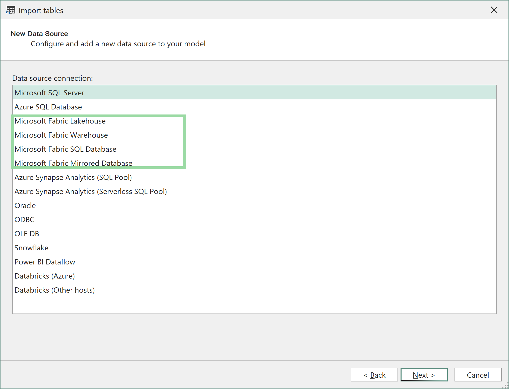
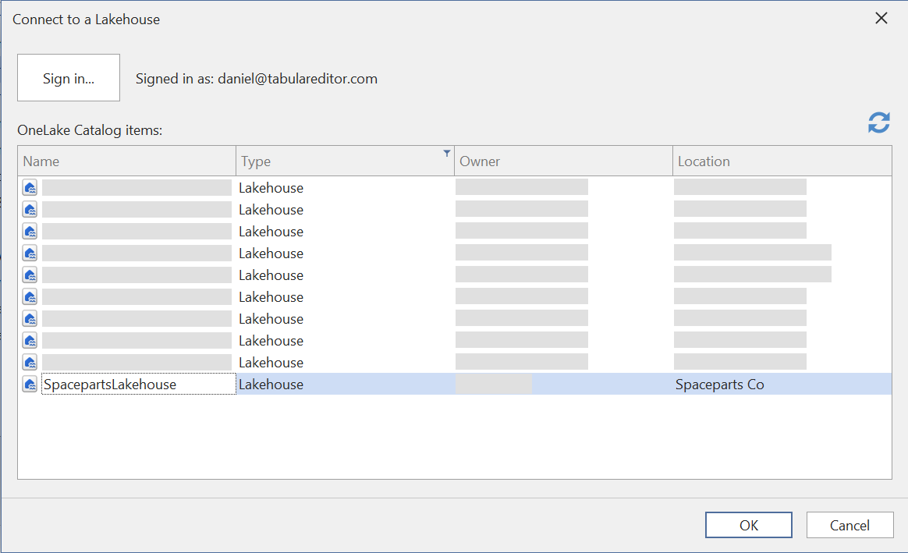
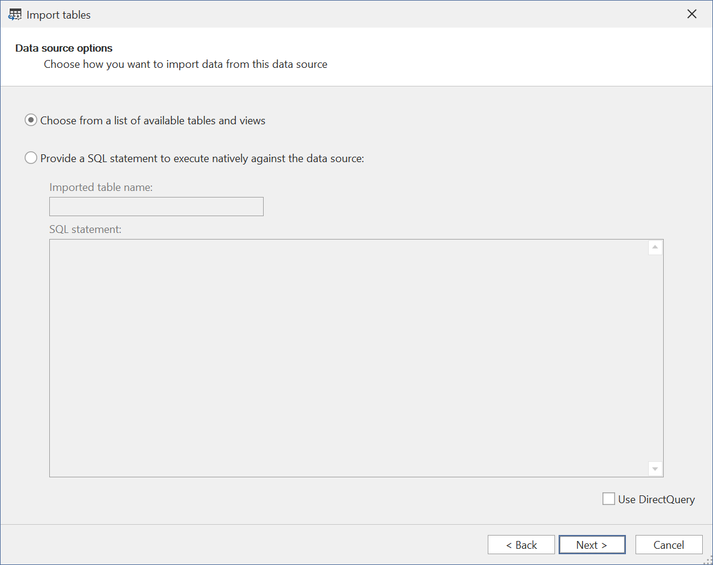
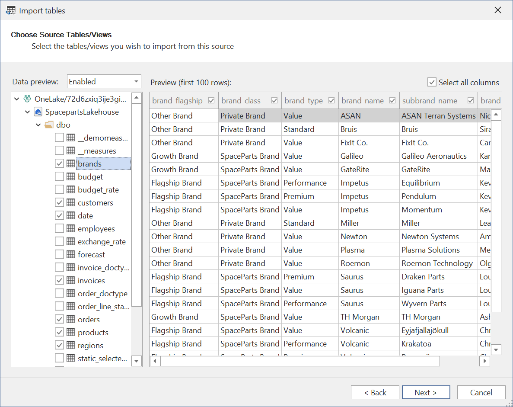
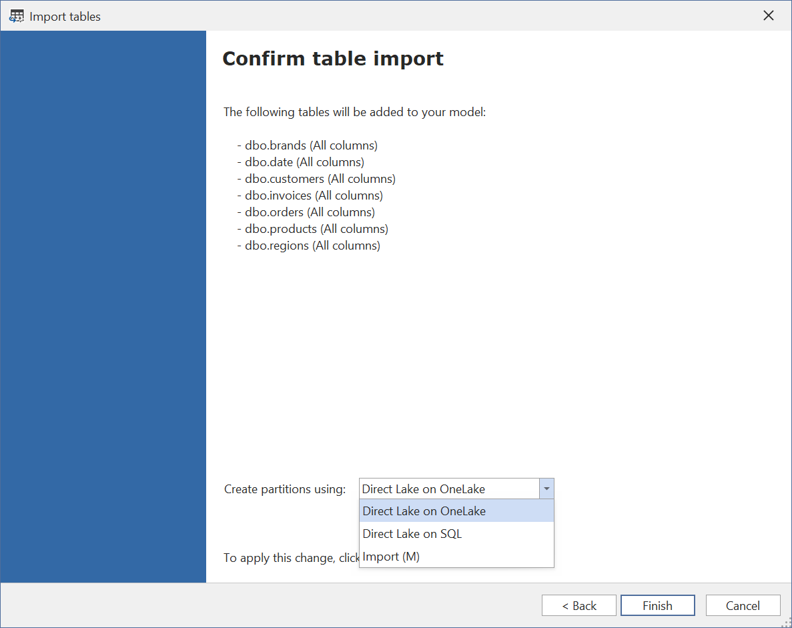
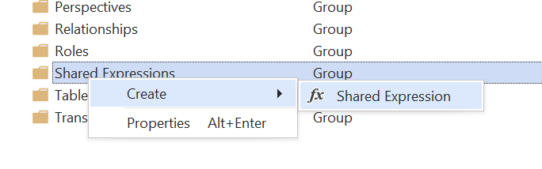
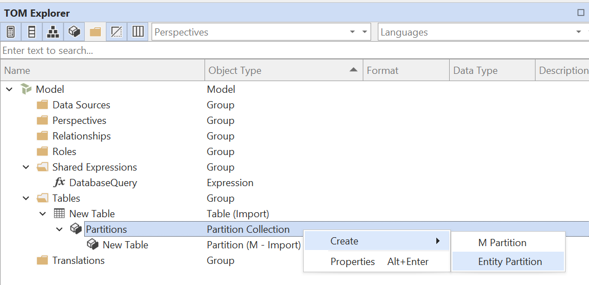
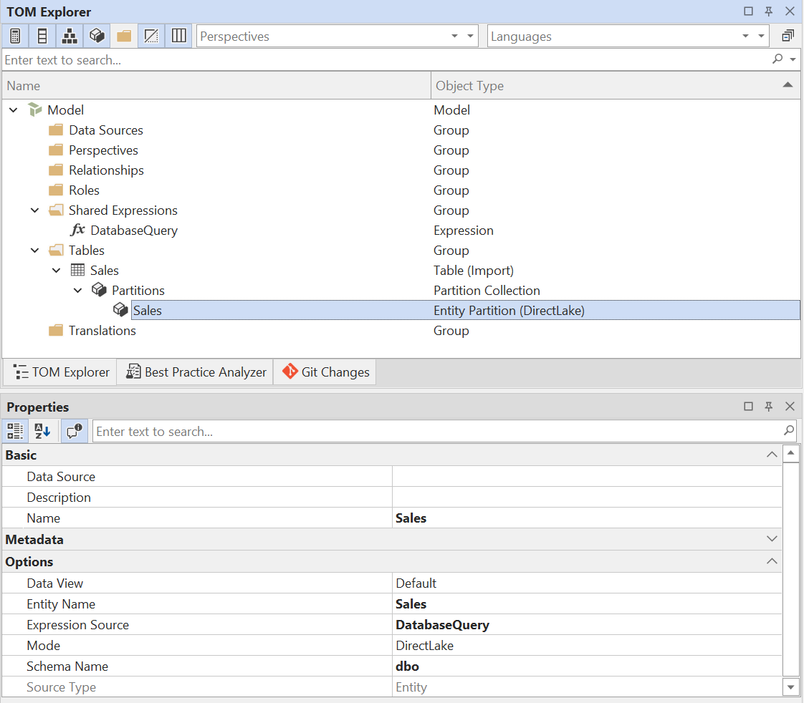
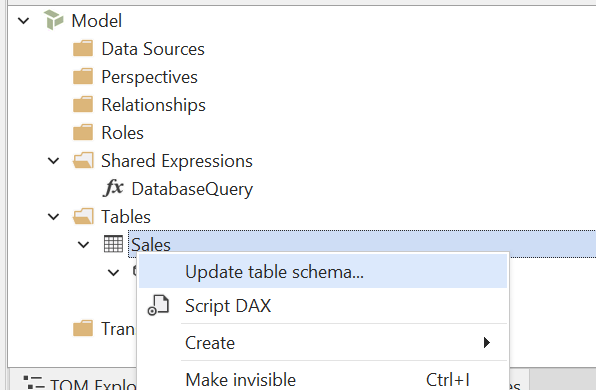
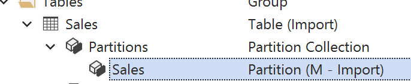

---
uid: direct-lake-guidance
title: Guía de Direct Lake
author: Morten Lønskov
updated: 2026-11-09
applies_to:
  products:
    - product: Tabular Editor 2
      partial: true
    - product: Tabular Editor 3
      since: 3.22.0
      editions:
        - edition: Desktop
          none: true
        - edition: Business
          none: true
        - edition: Enterprise
          full: true
---

# Guía de Direct Lake

Con el lanzamiento de Tabular Editor 3.22.0, hemos añadido compatibilidad con Direct Lake en OneLake, además de con Direct Lake en SQL. Este artículo ofrece una breve descripción de las diferencias entre estos dos modos y de cómo se comparan con otros modos de almacenamiento disponibles en modelos semánticos de Power BI.

## Resumen de los modos de almacenamiento

La siguiente tabla resume los modos de almacenamiento disponibles en modelos semánticos de Power BI:

| Modo de almacenamiento | Descripción                                                                                                                                                                                                           | Casos de uso recomendados                                                                                                                                                          |
| ---------------------- | --------------------------------------------------------------------------------------------------------------------------------------------------------------------------------------------------------------------- | ---------------------------------------------------------------------------------------------------------------------------------------------------------------------------------- |
| Import                 | Los datos se importan al modelo semántico y se almacenan en la caché en memoria del modelo (VertiPaq).                                                                             | Cuando necesite un rendimiento de consulta rápido y pueda permitirse actualizar los datos periódicamente.                                                          |
| DirectQuery            | Los datos se consultan directamente desde el origen en el momento de la consulta, sin importarse al modelo. Admite varios orígenes, como SQL, KQL e incluso otros modelos semánticos. | Cuando necesite acceso a datos en tiempo real o cuando el volumen de datos sea demasiado grande para caber en memoria.                                             |
| Dual                   | Un modo híbrido en el que el motor puede elegir entre devolver los datos importados o delegar en DirectQuery, según el contexto de la consulta.                                                       | Cuando tu modelo contiene una mezcla de tablas DirectQuery e Import (por ejemplo, al usar agregaciones) y tienes tablas relacionadas con ambas. |
| Direct Lake en OneLake | Utiliza el formato de almacenamiento Delta Parquet para cargar rápidamente los datos en la memoria del modelo semántico cuando sea necesario.                                                         | Cuando tus datos ya están disponibles como tablas o vistas materializadas en un Warehouse o Lakehouse de Fabric.                                                   |
| Direct Lake en SQL     | Versión anterior de Direct Lake que utiliza el punto de conexión de análisis SQL de un Warehouse o un Lakehouse de Fabric.                                                                            | No se recomienda para nuevos desarrollos (utilice Direct Lake en OneLake en su lugar).                                                          |

> [!NOTE]
> También es posible crear tablas que contengan una combinación de particiones en modo **Import** y **DirectQuery** (también conocidas como "tablas híbridas"). Esto se suele hacer en tablas de hechos grandes que requieren actualización incremental, mientras que parte de los datos se consulta directamente desde el origen. Consulta [este artículo](https://learn.microsoft.com/power-bi/connect-data/incremental-refresh-xmla) para obtener más información.

## Direct Lake en OneLake vs. Direct Lake en SQL

[Direct Lake en OneLake](https://learn.microsoft.com/fabric/fundamentals/direct-lake-overview#key-concepts-and-terminology) se introdujo en marzo de 2025 como alternativa a Direct Lake en SQL. Con Direct Lake en OneLake, no hay dependencia del punto de conexión SQL ni se recurre al modo DirectQuery. Esto también significa que las [restricciones habituales de los modelos DirectQuery](https://learn.microsoft.com/power-bi/connect-data/desktop-directquery-about#modeling-limitations) no se aplican a los modelos Direct Lake en OneLake.

> [!NOTE]
> Direct Lake en OneLake está actualmente en vista previa pública. Debes habilitar la configuración del inquilino **User can create Direct Lake on OneLake semantic models (preview)** en el portal de administración de Fabric antes de poder crear modelos semánticos con este modo de almacenamiento de tablas.

Sin embargo, al igual que con Direct Lake en SQL, siguen existiendo algunas [limitaciones que _sí_ se aplican](https://learn.microsoft.com/fabric/fundamentals/direct-lake-overview#considerations-and-limitations). Entre las principales limitaciones se incluyen:

- Las columnas calculadas en las tablas de Direct Lake en OneLake son compatibles en la versión preliminar y solo con el contexto de expresión `UserContext`. Direct Lake en SQL no admite columnas calculadas. Consulte [Columnas calculadas en Direct Lake en OneLake](#calculated-columns-on-direct-lake-on-onelake).
- Las tablas calculadas no pueden hacer referencia a columnas ni tablas en el modo de almacenamiento Direct Lake. Se admiten los grupos de cálculo, los parámetros de tipo what-if y los parámetros de campo, porque crean tablas calculadas implícitas que no hacen referencia a columnas de Direct Lake.
- Las vistas SQL no materializadas no se admiten como Data sources para tablas de Direct Lake en OneLake. Usa vistas materializadas o asegúrate de que la tabla Delta de origen contenga las columnas que necesitas.

Para obtener una lista completa y actualizada de las limitaciones, consulta la [documentación de Microsoft sobre consideraciones y limitaciones de Direct Lake](https://learn.microsoft.com/fabric/fundamentals/direct-lake-overview#considerations-and-limitations).

### Columnas calculadas en Direct Lake en OneLake

Una columna calculada de una tabla de Direct Lake en OneLake debe tener su propiedad `ExpressionContext` establecida en `UserContext`. La columna se evalúa en el momento de la consulta y no se materializa, por lo que no se puede usar en una relación. Las nuevas columnas calculadas usan `Standard` de forma predeterminada. Si una columna calculada de una tabla Direct Lake está configurada como `Standard` cuando guarda el modelo en el servicio Power BI, el guardado falla con el error «El contexto de expresión predeterminado no se puede usar para columnas calculadas en tablas Direct Lake».

La propiedad **Contexto de expresión** aparece en la @properties-view solo cuando el nivel de compatibilidad del modelo es 1705 o superior. Establézcala en cada columna calculada de una tabla Direct Lake en OneLake:

1. Seleccione el modelo en la @tom-explorer-view y compruebe el **Nivel de compatibilidad** en **Base de datos** en la @properties-view. Si es inferior a 1705, actualice el modelo como se describe en @update-compatibility-level.
2. Seleccione la columna calculada en la @tom-explorer-view.
3. En **Opciones** en la @properties-view, establezca **Contexto de expresión** en `UserContext`.
4. Guarde el modelo.

Las columnas calculadas de las tablas de importación del mismo modelo pueden usar cualquiera de los dos contextos de expresión. Para los objetos que no pueden hacer referencia a una columna de contexto de usuario, consulte @user-context-calculated-columns. Microsoft enumera las combinaciones admitidas de modo de almacenamiento y contexto de expresión en [Uso de columnas calculadas en Power BI Desktop](https://learn.microsoft.com/power-bi/transform-model/desktop-calculated-columns#materialization-and-performance).

### Modelos compuestos

Si necesita una columna calculada que esté materializada o que se pueda usar como clave de relación, cree un **modelo compuesto** combinando tablas Direct Lake con tablas de importación y añada la columna calculada a una tabla de importación. Esto es compatible con Direct Lake en OneLake, pero no con Direct Lake en SQL. En un modelo compuesto, normalmente mantiene las tablas de hechos más grandes en modo Direct Lake mientras utiliza el modo Importación para las tablas de dimensiones más pequeñas en las que necesita columnas calculadas completas o agrupaciones personalizadas.

Direct Lake en OneLake también admite la combinación con tablas DirectQuery mediante herramientas basadas en XMLA, como Tabular Editor. Las tablas en modo Import se pueden agregar mediante el modelado web de Power BI, Power BI Desktop (edición en vivo) o mediante herramientas XMLA.

> [!NOTE]
> Direct Lake en SQL no admite modelos compuestos. No puedes combinar tablas de Direct Lake en SQL con tablas en modo de almacenamiento Import, DirectQuery o Dual en el mismo modelo semántico. Sin embargo, puedes usar Power BI Desktop para crear un modelo compuesto _sobre_ un modelo semántico de Direct Lake en SQL y ampliarlo con tablas nuevas. Para más información, consulta [Crear un modelo compuesto en un modelo semántico](https://learn.microsoft.com/power-bi/transform-model/desktop-composite-models#building-a-composite-model-on-a-semantic-model-or-model).

## Intercalación

Al usar **Direct Lake en OneLake**, la intercalación del modelo es la misma que la de un modelo en modo Import mode, que de forma predeterminada no distingue mayúsculas de minúsculas.

En un modelo **Direct Lake en SQL**, la intercalación no distingue mayúsculas de minúsculas para las consultas que no recurren a DirectQuery. Si la consulta necesita recurrir a DirectQuery, la intercalación depende de la intercalación del origen. En un Warehouse de Fabric, la intercalación puede distinguir mayúsculas de minúsculas; en ese caso, deberías especificar una [intercalación que distinga mayúsculas de minúsculas en el modelo](https://data-goblins.com/power-bi/case-specific).

> [!NOTE]
> No puedes cambiar la intercalación de un modelo una vez que los metadatos se han desplegado en Analysis Services / Power BI. Por lo tanto, si planeas usar Direct Lake en SQL con un Warehouse de Fabric con distinción entre mayúsculas y minúsculas, debes establecer la intercalación en los metadatos del modelo antes de implementarlo:
>
> 1. Crea un nuevo modelo en Tabular Editor 3 (Archivo > Nuevo > Modelo...)
> 2. Desmarca "Use Workspace database"
> 3. Establece la propiedad **Collation** del modelo en `Latin1_General_100_BIN2_UTF8`
> 4. Guarda el modelo (Ctrl+S).
> 5. Ahora, abre el modelo desde el archivo que acabas de guardar. Cuando se te solicite conectarte a una base de datos del Workspace, elige "Sí".
>
> Con este enfoque, los metadatos del modelo se implementan desde el inicio con la intercalación correcta, y luego puedes agregar tablas en modo Direct Lake en SQL sin encontrarte con problemas de intercalación.

## Asistente para importar tablas

Para agregar tablas Direct Lake con el Asistente para importar tablas de Tabular Editor 3, elige **Microsoft Fabric Lakehouse**, **Microsoft Fabric Warehouse**, **Microsoft Fabric SQL Database** o **Microsoft Fabric Mirrored Database** como origen:



Tras iniciar sesión, se te mostrará una lista de todos los Lakehouses y Warehouses de Fabric disponibles en los Workspaces a los que tengas acceso. Selecciona el que quieras para conectarte y pulsa **Aceptar**:



A menos que quieras especificar una consulta SQL personalizada o configurar las tablas para el modo DirectQuery, simplemente pulsa **Siguiente** para seleccionar las tablas desde una lista de tablas/vistas en el origen:



Selecciona las tablas/vistas que quieras importar. Ten en cuenta que las **vistas no materializadas** no se admiten en el modo Direct Lake en OneLake. Al intentar agregar una vista de este tipo al modelo, se producirá un error al guardar los metadatos del modelo.



En la última página, elige con qué modo quieres que se configure la partición de la tabla:



Las opciones son:

- Direct Lake en OneLake
- Direct Lake en SQL
- Importación (M)

> [!NOTE]
> Si estás trabajando en un modelo que ya contiene tablas, es posible que una o varias de las opciones mencionadas anteriormente no estén disponibles si el modelo no admite combinar tablas con distintos modos de almacenamiento. Por ejemplo, si el modelo contiene una tabla en modo Direct Lake en SQL, no puedes agregar tablas en otros modos.

La tabla importada ya incluye sus columnas, en el mismo orden que en el origen, y no es necesario ejecutar **Actualizar esquema de tabla** después de la importación. Si Tabular Editor no puede determinar el punto de conexión de análisis SQL del Lakehouse o del Warehouse, y la configuración de importación no especifica uno, la importación falla con un error que indica la configuración que falta y no se crea ninguna tabla.

## Dimensiones con asignación de roles

Una *dimensión con asignación de roles* es una tabla de dimensiones relacionada con más de una columna de la misma tabla de hechos; por ejemplo, una tabla de fechas relacionada tanto con la fecha del pedido como con la fecha de envío de una tabla de ventas. Elige una configuración para el modelo semántico de Direct Lake:

| Configuración | Tablas del modelo | Requiere |
|-------|--------------|----------|
| Relaciones inactivas | Una tabla de fechas con una relación activa con una columna de fechas y relaciones inactivas con las demás. Las medidas para los demás roles activan su relación con [USERELATIONSHIP](https://dax.guide/userelationship). | Cualquier modelo Direct Lake |
| Una tabla de origen por rol | Una tabla Direct Lake por tabla Delta, por ejemplo, `DimDate` y `DimShipDate`. | Una tabla separada para cada rol en el lakehouse/almacén |
| Importar tablas para los roles adicionales | Una tabla de fechas Direct Lake para el rol principal y tablas de importación para los demás roles. Consulta [Modelos compuestos](#composite-models). | Direct Lake en OneLake |
| Tabla Direct Lake duplicada | Una copia de la tabla «Date», creada con **Duplicar** en el **Explorador TOM**, que lee la misma tabla Delta. | Nuevas tablas agregadas con el [Asistente para la importación de tablas](#table-import-wizard). Consulte [Tablas Direct Lake duplicadas](#duplicated-direct-lake-tables). |
| Un acceso directo por rol | Una copia de la tabla «Date» para cada rol, cada una de las cuales lee su propio acceso directo de OneLake a la misma tabla Delta. Consulte [Un acceso directo por rol](#one-shortcut-per-role). | Un acceso directo para cada rol en el Lakehouse |

### Tablas Direct Lake duplicadas

Una tabla Direct Lake duplicada conserva los valores `SourceLineageTag` de la tabla original y de sus columnas. En una tabla de Direct Lake, `SourceLineageTag` contiene el nombre de la tabla o columna del lakehouse/almacén, por lo que la tabla original y la copia leen la misma tabla Delta. Aunque el modelo contiene ambas tablas, al intentar añadir una tabla a través del cuadro de diálogo **Editar tablas** en el modelado web de Power BI, se produce un error que indica «La secuencia contiene más de un elemento coincidente». El [Asistente para la importación de tablas](#table-import-wizard) añade tablas a un modelo que contiene tablas Direct Lake duplicadas. Si la copia lee un acceso directo, como se describe en [Un acceso directo por rol](#one-shortcut-per-role), **Editar tablas** funciona en el modelo.

Cuando elimina una tabla Direct Lake en el modelado web de Power BI, la tabla de origen se agrega a la anotación `PBI_RemovedChildren` de la expresión compartida. Si otra tabla del modelo lee la misma tabla Delta, el modelado web de Power BI falla con el error «No se puede eliminar y añadir un elemento secundario al mismo tiempo» cuando enumera las tablas del lakehouse/almacén. Elimine la entrada en Tabular Editor 3:

1. Abre el modelo semántico en Tabular Editor 3.
2. En la @tom-explorer-view, expanda **Expresiones compartidas** y seleccione la expresión a la que hacen referencia las particiones Direct Lake, normalmente `DatabaseQuery`.
3. En la @properties-view, en **Anotaciones**, quite la entrada de la tabla Delta del valor `PBI_RemovedChildren`. Elimine la anotación si no quedan entradas.
4. Guarde el modelo.

Microsoft describe la anotación en [Etiquetas de linaje para modelos semánticos de Power BI](https://learn.microsoft.com/analysis-services/tom/lineage-tags-for-power-bi-semantic-models).

### Un acceso directo por rol

Un [acceso directo de OneLake](https://learn.microsoft.com/fabric/onelake/onelake-shortcuts) aparece como una tabla independiente en el lakehouse y lee la tabla Delta a la que apunta. Microsoft admite los accesos directos como orígenes tanto para Direct Lake en OneLake como para Direct Lake en tablas SQL. Cuando cada tabla de roles lee su propio acceso directo, cada tabla de Direct Lake del modelo tiene su propia tabla de origen, y las funciones **Editar tablas** y Actualizar de Power BI funcionan en el modelo. Las copias conservan los nombres de las columnas, las descripciones, las carpetas de visualización y otros cambios realizados en la tabla original.

1. En el Lakehouse, cree un acceso directo en **Tablas** para cada rol adicional, con la tabla Delta de la dimensión como destino. Por ejemplo, cree `d_date_ship` con `d_date` como destino.
2. En la @tom-explorer-view, haga clic con el botón derecho en la tabla original, seleccione **Duplicar** y cambie el nombre de la copia.
3. Expanda **Particiones** bajo la copia, seleccione su partición de entidad y establezca **Nombre de entidad** en la @properties-view con el nombre del acceso directo.
4. Seleccione la copia y establezca **Etiqueta de linaje de origen** con el nombre del acceso directo, en el mismo formato que el valor de la tabla original. Si la tabla original tiene `[dbo].[d_date]`, introduzca `[dbo].[d_date_ship]`.
5. Guarde el modelo.

Las columnas de la copia conservan sus valores `SourceColumn` y `SourceLineageTag`, que coinciden con las columnas del acceso directo. **Duplicar** copia las medidas de la tabla original con nuevos nombres. Elimine las medidas que la tabla de roles no necesita.

## Inspeccionar una partición de Direct Lake

Una partición de Direct Lake no tiene expresión de consulta. Al seleccionar una en @tom-explorer-view, el **Editor de expresiones** muestra su `Data Coverage Definition Expression` o nada si la partición no tiene una definición de cobertura de datos. Las particiones generadas por una política de actualización incremental se comportan igual.

## Expresiones de Power Query (M)

Esta sección incluye una descripción más técnica de cómo deben configurarse los objetos y las propiedades de TOM, en caso de que quieras configurar manualmente tablas para el modo Direct Lake sin usar el Asistente para importar tablas.

### Direct Lake en OneLake

Para configurar manualmente una tabla en el modo **Direct Lake en OneLake**, debes hacer lo siguiente:

1. **Crear expresión compartida**: las tablas de Direct Lake usan particiones de tipo "Entity", que deben hacer referencia a una expresión compartida en el modelo. Empieza por crear esta expresión compartida si todavía no la tienes. Asígnale el nombre `DatabaseQuery`:



2. **Configurar la expresión compartida**: Establece la propiedad **Kind** de la expresión que creaste en el paso 1 en "M" y la propiedad **Expression** en la siguiente consulta M, sustituyendo los ID de la URL por los correspondientes a tu Workspace de Fabric y a tu Lakehouse/Warehouse:

```m
let
    Source = AzureStorage.DataLake("https://onelake.dfs.fabric.microsoft.com/<workspace-id>/<resource-id>", [HierarchicalNavigation=true])
in
    Source
```

3. **Crear tabla y partición de entidad**: crea una nueva tabla en el modelo (Alt+5), luego expande las particiones de la tabla en el Explorador TOM y crea una nueva _Entity Partition_:



Elimina la partición de importación estándar que se creó automáticamente al crear la tabla.

4. **Configurar la partición de entidad**: establece las siguientes propiedades en la partición de entidad:

| Propiedad              | Valor                                                                                                                                                                                                   |
| ---------------------- | ------------------------------------------------------------------------------------------------------------------------------------------------------------------------------------------------------- |
| Nombre                 | (Recomendado) Establécelo con el mismo nombre que la tabla                                                                                                                           |
| Nombre de entidad      | (Obligatorio) Establécelo con el nombre de la tabla en el Lakehouse/Warehouse                                                                                                        |
| Origen de la expresión | (Obligatorio) Establécelo en la expresión compartida que creaste en el paso 1; normalmente `DatabaseQuery`                                                                           |
| Modo                   | (Obligatorio) `DirectLake`                                                                                                                                                           |
| Nombre del esquema     | (Opcional) Establécelo con el nombre del esquema en el Lakehouse/Warehouse, si corresponde. Si no lo configuras, se usará el esquema predeterminado. |

El resultado final debería verse así:



5. **Actualizar metadatos de columnas**: En este punto, deberías poder usar la función **Update Table Schema** de Tabular Editor para actualizar los metadatos de las columnas de la tabla. Esto recuperará automáticamente los nombres de las columnas y los tipos de datos desde el Lakehouse/Warehouse:



Como alternativa, agrega manualmente columnas de datos a la tabla (Alt+4) y especifica `Name`, `Data Type`, `Source Column` y cualquier otra propiedad relevante para cada columna.

> [!NOTE]
> Cuando se agrega una tabla de Direct Lake al modelo, es necesario "actualizarla" manualmente después de la primera implementación de metadatos. De lo contrario, la tabla no contendrá datos cuando se consulte. Esta actualización solo debe realizarse una vez. Tabular Editor 3 actualizará automáticamente la tabla al guardar los metadatos del modelo, si está activada la opción **Actualizar automáticamente al guardar nuevas tablas** en **Herramientas > Preferencias > Implementación del modelo > Actualización de datos**.

### Direct Lake en SQL

Para configurar manualmente una tabla en modo **Direct Lake en SQL**, sigue los pasos de la sección anterior para Direct Lake en OneLake, pero usa en su lugar la siguiente consulta M en la expresión compartida:

```m
let
    database = Sql.Database("<sql-endpoint>", "<warehouse/lakehouse name>")
in
    database
```

Reemplaza `<sql-endpoint>` por la cadena de conexión del [punto de conexión de análisis SQL del Warehouse de Fabric](https://learn.microsoft.com/fabric/data-warehouse/query-warehouse) o del [Lakehouse](https://learn.microsoft.com/fabric/data-engineering/lakehouse-sql-analytics-endpoint), y `<warehouse/lakehouse name>` por el nombre del Warehouse o del Lakehouse.

### Importar desde Lakehouse / Warehouse

Si quieres configurar una tabla en modo **Import** y obtener los datos de un Lakehouse o Warehouse de Fabric, sigue estos pasos:

1. **Crear tabla**: Crea una tabla nueva en el modelo (Alt+5) y, después, expande las particiones de la tabla en el Explorador TOM. De forma predeterminada, deberías ver una única partición de tipo "Import" creada automáticamente:



2. **Configurar la partición Import**: Establece la siguiente consulta M en la partición Import:

```m
let
    Source = Sql.Database("<sql-endpoint>","<warehouse/lakehouse name>"),
    Data = Source{[Schema="<schema-name>",Item="<table/view-name>"]}[Data]
in
    Data
```

Reemplaza `<sql-endpoint>` por la cadena de conexión del [punto de conexión de análisis SQL del Warehouse de Fabric](https://learn.microsoft.com/fabric/data-warehouse/query-warehouse) o del [Lakehouse](https://learn.microsoft.com/fabric/data-engineering/lakehouse-sql-analytics-endpoint), y `<warehouse/lakehouse name>` por el nombre del Warehouse o del Lakehouse.

Reemplaza `<schema-name>` por el nombre del esquema en el Warehouse/Lakehouse y `<table/view-name>` por el nombre de la tabla o vista que quieras importar. Ten en cuenta que las tablas en Import mode pueden usar vistas no materializadas como Data source, ya que los datos se consultan a través del punto de conexión de análisis SQL durante las operaciones de actualización.

3. **Actualizar metadatos de columnas** (solo configuración manual): como una partición configurada manualmente no tiene columnas, puede usar la característica **Actualizar esquema de tabla** de Tabular Editor para recuperar los nombres de las columnas y los tipos de datos del Lakehouse/Warehouse. Como alternativa, crea columnas de datos manualmente (**Alt+4**) y especifica `Name`, `Data Type`, `Source Column` y cualquier otra propiedad relevante para cada columna.

## Conversión entre modos de almacenamiento

Es sencillo convertir entre Direct Lake en SQL y Direct Lake en OneLake usando la información de este artículo, porque solo necesitas modificar la consulta M de la expresión compartida a la que hacen referencia las particiones de Direct Lake.

Si quieres convertir de Import a Direct Lake, es un poco más complicado debido a los distintos tipos de partición implicados.

Para ponértelo más fácil, hemos preparado un conjunto de C# Scripts que pueden ayudarte a convertir entre distintos modos de almacenamiento:

- [Convertir Direct Lake en SQL a Direct Lake en OneLake](xref:script-convert-dlsql-to-dlol)
- [Convertir Import a Direct Lake en OneLake](xref:script-convert-import-to-dlol)