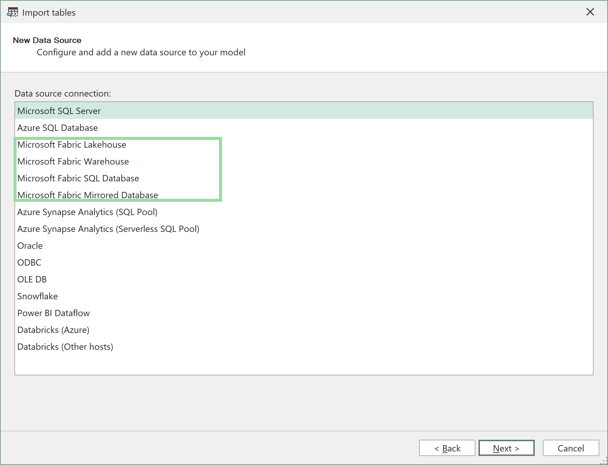
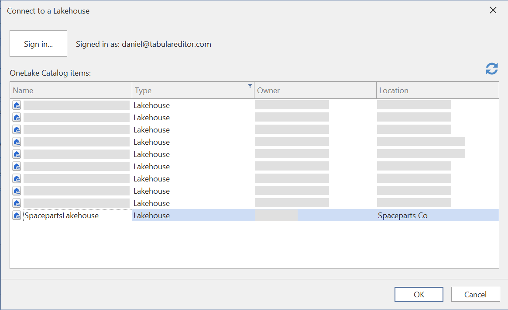
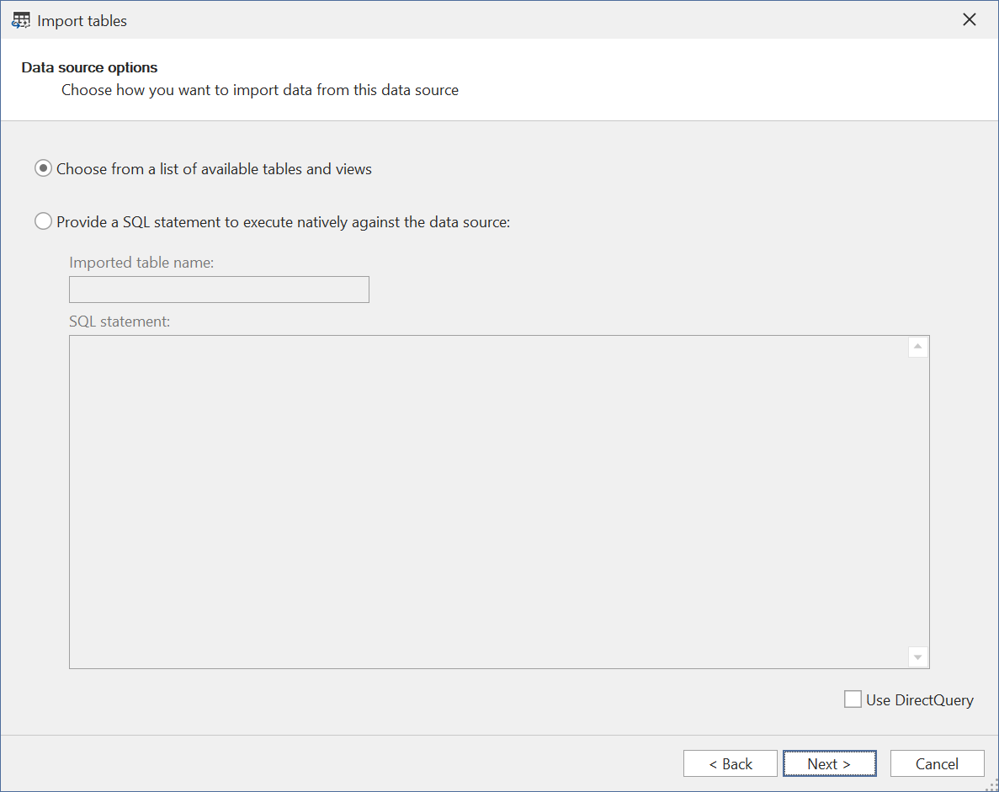
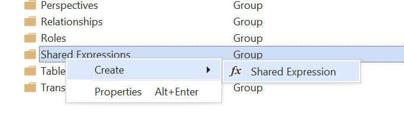
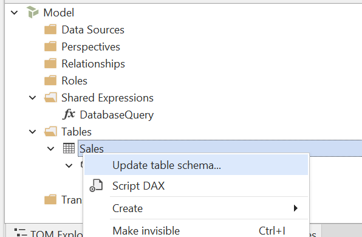

---
uid: direct-lake-guidance
title: Guía de Direct Lake
author: Morten Lønskov
updated: 2026-10-26
applies_to:
  products:
    - product: Tabular Editor 2
      partial: true
    - product: Tabular Editor 3
      since: 3.22.0
      editions:
        - edition: Desktop
          none: true
        - edition: Business
          none: true
        - edition: Enterprise
          full: true
---
# Guía de Direct Lake

Con el lanzamiento de Tabular Editor 3.22.0, hemos añadido compatibilidad con Direct Lake en OneLake, además de con Direct Lake en SQL. Este artículo ofrece una breve descripción general de las diferencias entre estos dos modos y cómo se comparan con otros modos de almacenamiento disponibles en los modelos semánticos de Power BI.

## Descripción general del modo de almacenamiento

La siguiente tabla resume los modos de almacenamiento disponibles en los modelos semánticos de Power BI:

| Modo de almacenamiento | Descripción | Casos de uso recomendados |
|--------------|-------------|-----------------------|
| Importación       | Los datos se importan al modelo semántico y se almacenan en la caché en memoria del modelo (VertiPaq). | Cuando necesitas un rendimiento rápido de las consultas y puedes permitirte actualizar los datos periódicamente. |
| DirectQuery  | Los datos se consultan directamente desde el origen en el momento de la consulta, sin importarlos al modelo. Admite varias fuentes, como SQL, KQL e incluso otros modelos semánticos. | Cuando necesitas acceder a los datos en tiempo real o cuando el volumen de datos es demasiado grande para caber en la memoria. |
| Dual         | Un modo híbrido en el que el motor puede elegir entre devolver los datos importados o delegar en DirectQuery, según el contexto de la consulta. | Cuando su modelo contiene una combinación de tablas DirectQuery e Import (por ejemplo, cuando se utilizan agregaciones) y tiene tablas que están relacionadas con ambas. |
| Direct Lake en OneLake | Utiliza el formato de almacenamiento Delta Parquet para intercambiar rápidamente los datos a la memoria del modelo semántico cuando sea necesario. | Cuando sus datos ya están disponibles como tablas o vistas materializadas en un almacén de Fabric o en un lakehouse. |
| Direct Lake en SQL | Versión anterior de Direct Lake que utiliza el punto de conexión de análisis de SQL de los almacenes o lakehouses de Fabric. | No se recomienda para nuevos desarrollos (utilice Direct Lake en OneLake en su lugar). |

> [!NOTE]
> También es posible crear tablas que contengan una combinación de particiones en modo **Importación** y **DirectQuery** (también conocidas como «tablas híbridas»). Esto suele hacerse en tablas de hechos grandes que requieren una actualización incremental mientras se consultan algunos datos directamente desde el origen. Consulta [este artículo](https://learn.microsoft.com/power-bi/connect-data/incremental-refresh-xmla) para obtener más información.

## Direct Lake en OneLake frente a Direct Lake en SQL

[Direct Lake en OneLake](https://learn.microsoft.com/fabric/fundamentals/direct-lake-overview#key-concepts-and-terminology) se introdujo en marzo de 2025 como alternativa a Direct Lake en SQL. Con Direct Lake en OneLake, no hay dependencia del punto de conexión SQL ni recurso al modo DirectQuery. Esto también significa que las [restricciones habituales que se aplican a los modelos DirectQuery](https://learn.microsoft.com/power-bi/connect-data/desktop-directquery-about#modeling-limitations) no se aplican a los modelos Direct Lake en OneLake.

> [!NOTE]
> Direct Lake en OneLake se encuentra actualmente en versión preliminar pública. Debe habilitar la configuración del inquilino **El usuario puede crear modelos semánticos de Direct Lake en OneLake (vista previa)** en el portal de administración de Fabric antes de poder crear modelos semánticos con este modo de almacenamiento de tablas.

Sin embargo, al igual que con Direct Lake en SQL, todavía hay algunas [limitaciones que *sí* se aplican](https://learn.microsoft.com/fabric/fundamentals/direct-lake-overview#considerations-and-limitations). Entre las limitaciones principales se incluyen las siguientes:

- Las columnas calculadas en las tablas de Direct Lake en OneLake son compatibles en la versión preliminar, y solo con el contexto de expresión `UserContext`. Direct Lake en SQL no admite columnas calculadas. Consulte [Columnas calculadas en Direct Lake en OneLake](#calculated-columns-on-direct-lake-on-onelake).
- Las tablas calculadas no pueden hacer referencia a columnas o tablas en el modo de almacenamiento Direct Lake. Los grupos de cálculos, los parámetros de simulación y los parámetros de campo son compatibles porque crean tablas calculadas implícitas que no hacen referencia a columnas Direct Lake.
- Las vistas SQL no materializadas no son compatibles como orígenes de datos para las tablas de Direct Lake en OneLake. Utilice vistas materializadas o asegúrese de que la tabla Delta de origen contenga las columnas que necesita.
- Los accesos directos en un lakehouse no son compatibles como fuentes de datos durante la vista previa pública de Direct Lake en OneLake.

Para obtener una lista completa y actualizada de las limitaciones, consulte la [documentación de Microsoft sobre consideraciones y limitaciones de Direct Lake](https://learn.microsoft.com/fabric/fundamentals/direct-lake-overview#considerations-and-limitations).

### Columnas calculadas en Direct Lake en OneLake

Una columna calculada de una tabla de Direct Lake en OneLake debe tener su propiedad `ExpressionContext` establecida en `UserContext`. La columna se evalúa en el momento de la consulta y no se materializa, por lo que no se puede usar en una relación. Las nuevas columnas calculadas usan `Standard` de forma predeterminada. Si una columna calculada de una tabla Direct Lake se establece en `Standard` cuando guarda el modelo en el servicio Power BI, el guardado falla con el error «El contexto de expresión predeterminado no se puede usar para columnas calculadas en tablas Direct Lake».

La propiedad **Contexto de expresión** aparece en la @properties-view solo cuando el nivel de compatibilidad del modelo es 1705 o superior. Establézcala en cada columna calculada de una tabla Direct Lake en OneLake:

1. Seleccione el modelo en la @tom-explorer-view y compruebe el **Nivel de compatibilidad** en **Base de datos** en la @properties-view. Si es inferior a 1705, actualice el modelo como se describe en @update-compatibility-level.
2. Seleccione la columna calculada en la @tom-explorer-view.
3. En **Opciones** en la @properties-view, establezca **Contexto de expresión** en `UserContext`.
4. Guarde el modelo.

Las columnas calculadas de las tablas de importación del mismo modelo pueden usar cualquiera de los dos contextos de expresión. Para los objetos que no pueden hacer referencia a una columna de contexto de usuario, consulte @user-context-calculated-columns. Microsoft enumera las combinaciones compatibles de modo de almacenamiento y contexto de expresión en [Uso de columnas calculadas en Power BI Desktop](https://learn.microsoft.com/power-bi/transform-model/desktop-calculated-columns#materialization-and-performance).

### Modelos compuestos

Si necesita una columna calculada que esté materializada o que se pueda usar como clave de relación, cree un **modelo compuesto** combinando tablas Direct Lake con tablas de importación y añada la columna calculada a una tabla de importación. Esto es compatible con Direct Lake en OneLake, pero no con Direct Lake en SQL. En un modelo compuesto, normalmente mantiene las tablas de hechos más grandes en modo Direct Lake, mientras que utiliza el modo Importación para las tablas de dimensiones más pequeñas en las que necesita columnas calculadas completas o agrupaciones personalizadas.

Direct Lake en OneLake también admite la combinación con tablas DirectQuery mediante herramientas basadas en XMLA, como Tabular Editor. Las tablas de importación se pueden añadir mediante el modelado web de Power BI, Power BI Desktop (edición en vivo) o mediante herramientas XMLA.

> [!NOTE]
> Direct Lake en SQL no admite modelos compuestos. No puede combinar tablas de Direct Lake en SQL con tablas en modo de almacenamiento de importación, DirectQuery o dual en el mismo modelo semántico. Sin embargo, puede utilizar Power BI Desktop para crear un modelo compuesto *sobre* un modelo semántico de Direct Lake en SQL y ampliarlo con nuevas tablas. Consulta [Crear un modelo compuesto sobre un modelo semántico](https://learn.microsoft.com/power-bi/transform-model/desktop-composite-models#building-a-composite-model-on-a-semantic-model-or-model) para obtener más información.

## intercalación

Cuando se utiliza **Direct Lake en OneLake**, la intercalación del modelo es la misma que la de un modelo de importación, que no distingue entre mayúsculas y minúsculas de forma predeterminada.

En el caso de un modelo **Direct Lake en SQL**, la intercalación no distingue entre mayúsculas y minúsculas en las consultas que no recurren a DirectQuery. Si la consulta sí recurre a DirectQuery, el intercalado depende del intercalado del origen. En el caso de un almacén de Fabric, es posible que la intercalación distinga entre mayúsculas y minúsculas. En ese caso, debe especificar una [intercalación que distinga entre mayúsculas y minúsculas en el modelo](https://data-goblins.com/power-bi/case-specific).

> [!NOTE]
> No se puede cambiar la intercalación de un modelo una vez que los metadatos se han implementado en Analysis Services / Power BI. Por lo tanto, si tiene previsto utilizar Direct Lake en SQL con un almacén de Fabric que distingue entre mayúsculas y minúsculas, debe establecer la intercalación en los metadatos del modelo antes de implementarlo:
>
> 1. Cree un nuevo modelo en Tabular Editor 3 (Archivo > Nuevo > Modelo...)
> 2. Desmarque «Usar base de datos del área de trabajo».
> 3. Establezca la propiedad ** intercalación ** del modelo como `Latin1_General_100_BIN2_UTF8`
> 4. Guarde el modelo (Ctrl+S).
> 5. Ahora, abra el modelo desde el archivo que acaba de guardar. Cuando se le pida que se conecte a una base de datos de área de trabajo, elija «Sí».
>
> Con este enfoque, los metadatos del modelo se implementan con el intercalado correcto desde el principio, y luego puedes añadir tablas en Direct Lake en modo SQL sin encontrarte con problemas de intercalado.

## Asistente para la importación de tablas

Para añadir tablas de Direct Lake utilizando el Asistente para la importación de tablas de Tabular Editor 3, elija **Microsoft Fabric Lakehouse**, **Microsoft Fabric Warehouse**, **Microsoft Fabric SQL Database** o **Microsoft Fabric Mirrored Database** como origen:



Después de iniciar sesión, se te mostrará una lista de todos los lakehouses/almacenes de Fabric disponibles en los espacios de trabajo a los que tienes acceso. Seleccione aquel al que desee conectarse y pulse **Aceptar**:



A menos que desee especificar una consulta SQL personalizada o configurar las tablas para el modo DirectQuery, simplemente pulse **Siguiente** para seleccionar las tablas de una lista de tablas/vistas del origen:



Selecciona las tablas/vistas que quieres importar. Tenga en cuenta que las **vistas no materializadas** no son compatibles con el modo Direct Lake en OneLake. Si intenta añadir una vista de este tipo al modelo, se producirá un error al guardar los metadatos del modelo.


En la última página, elija con qué modo desea que se configure la partición de la tabla:


Las opciones son:

- Direct Lake en OneLake
- Direct Lake en SQL
- Importar (M)

> [!NOTE]
> Si está trabajando en un modelo que ya contiene tablas, es posible que una o varias de las opciones mencionadas anteriormente no estén disponibles si el modelo no admite la combinación de tablas en diferentes modos de almacenamiento. Por ejemplo, si el modelo contiene una tabla en modo Direct Lake en SQL, no puede añadir tablas en otros modos.

La tabla importada ya tiene sus columnas, en el mismo orden que en el origen, y no es necesario ejecutar **Actualizar esquema de tabla** después de la importación. Si Tabular Editor no puede determinar el punto de conexión de análisis SQL del lakehouse o del almacén y los ajustes de importación no especifican ninguno, la importación falla con un error que indica el ajuste que falta y no se crea ninguna tabla.

## Inspección de una partición Direct Lake

Una partición de Direct Lake no tiene expresión de consulta. Cuando selecciona una en la @tom-explorer-view, el **Editor de expresiones** muestra su `Data Coverage Definition Expression`, o nada si la partición no tiene una definición de cobertura de datos. Las particiones generadas por una directiva de actualización incremental se comportan de la misma manera.

## Expresiones de Power Query (M)

Esta sección contiene una descripción más técnica sobre cómo deben configurarse los objetos y las propiedades de TOM, en caso de que desee configurar manualmente las tablas para el modo Direct Lake sin utilizar el Asistente para la importación de tablas.

### Direct Lake en OneLake

Para configurar manualmente una tabla para el modo **Direct Lake en OneLake**, debe hacer lo siguiente:

1. **Crear una expresión compartida**: Las tablas de Direct Lake utilizan particiones de «Entidad», que deben hacer referencia a una expresión compartida en el modelo. Empieza por crear esta expresión compartida, si aún no la tienes. Llámala `DatabaseQuery`:



2. **Configurar la expresión compartida**: Establezca la propiedad **Tipo** de la expresión que creó en el paso 1 en «M» y establezca la propiedad **Expresión** en la siguiente consulta M, sustituyendo los identificadores de la URL por los de su área de trabajo de Fabric y su lakehouse/almacén:

```m
let
    Source = AzureStorage.DataLake("https://onelake.dfs.fabric.microsoft.com/<workspace-id>/<resource-id>", [HierarchicalNavigation=true])
in
    Source
```

3. **Crear tabla y partición de entidad**: Cree una nueva tabla en el modelo (Alt+5), luego expanda las particiones de tabla en el Explorador TOM y cree una nueva *Partición de entidad*:
  
  

  Elimine la partición de importación normal que se creó automáticamente cuando creó la tabla.

4. **Configurar la partición de entidad**: Establezca las siguientes propiedades en la partición de entidad:

| Propiedad | Valor |
| ----------|-------|
| Nombre | (Recomendado) Establecer el mismo nombre que la tabla |
| Nombre de la entidad | (Obligatorio) Establecer el nombre de la tabla en el lakehouse/almacén |
| Origen de la expresión | (Obligatorio) Establezca la expresión compartida que creó en el paso 1, normalmente `DatabaseQuery` |
| Modo | (Obligatorio) `DirectLake` |
| Nombre del esquema | (Opcional) Establézcalo como el nombre del esquema en el lakehouse/almacén, si corresponde. Si no se establece, se usará el esquema predeterminado. |

  El resultado final debería tener este aspecto:


5. **Actualizar los metadatos de las columnas**: En esta fase, debería poder utilizar la función **Actualizar esquema de tabla** de Tabular Editor para actualizar los metadatos de las columnas de la tabla. Esto recuperará automáticamente los nombres de las columnas y los tipos de datos del lakehouse/almacén:



  Como alternativa, añada manualmente columnas de datos a la tabla (Alt+4) y especifique `Name`, `Data Type`, `Source Column` y cualquier otra propiedad relevante para cada columna.

> [!NOTE]
> Cuando se agrega una tabla Direct Lake al modelo, es necesario «actualizarla» manualmente después de la primera implementación de metadatos. De lo contrario, la tabla no contendrá ningún dato cuando se consulte. Esta actualización solo debe realizarse una vez. Tabular Editor 3 actualizará automáticamente la tabla cuando se guarden los metadatos del modelo, si está activada la opción **Actualización automática al guardar nuevas tablas** en **Herramientas > Preferencias > Implementación del modelo > Actualización de datos**.

### Direct Lake en SQL

Para configurar manualmente una tabla para el modo **Direct Lake en SQL**, siga los pasos de la sección anterior para Direct Lake en OneLake, pero utilice la siguiente consulta M en la expresión compartida:

```m
let
    database = Sql.Database("<sql-endpoint>", "<warehouse/lakehouse name>")
in
    database
```

Sustituye `<sql-endpoint>` por la cadena de conexión del [punto de conexión de análisis SQL del almacén de Fabric](https://learn.microsoft.com/fabric/data-warehouse/query-warehouse) o del [lakehouse](https://learn.microsoft.com/fabric/data-engineering/lakehouse-sql-analytics-endpoint), y `<warehouse/lakehouse name>` por el nombre del almacén o del lakehouse.

### Importación desde Lakehouse / Warehouse

Si quieres configurar una tabla para el modo **Importación** mientras obtienes datos de un Lakehouse o Warehouse de Fabric, los pasos son los siguientes:

1. **Crear tabla**: Cree una nueva tabla en el modelo (Alt+5) y, a continuación, expanda las particiones de la tabla en el Explorador TOM. De forma predeterminada, debería ver una única partición de tipo «Importación» creada automáticamente:


2. **Configurar la partición de importación**: Establezca la siguiente consulta M en la partición de importación:

```m
let
    Source = Sql.Database("<sql-endpoint>","<warehouse/lakehouse name>"),
    Data = Source{[Schema="<schema-name>",Item="<table/view-name>"]}[Data]
in
    Data
```

Sustituye `<sql-endpoint>` por la cadena de conexión del [punto de conexión de análisis SQL del almacén de Fabric](https://learn.microsoft.com/fabric/data-warehouse/query-warehouse) o del [lakehouse](https://learn.microsoft.com/fabric/data-engineering/lakehouse-sql-analytics-endpoint), y `<warehouse/lakehouse name>` por el nombre del almacén o del lakehouse.

Sustituya `<schema-name>` por el nombre del esquema en el almacén/lakehouse y `<table/view-name>` por el nombre de la tabla o vista que quiera importar. Tenga en cuenta que las tablas en modo de importación pueden usar vistas no materializadas como origen de datos, ya que los datos se consultan a través del punto de conexión SQL durante las operaciones de actualización.

3. **Actualizar los metadatos de las columnas** (solo en la configuración manual): dado que una partición que ha configurado manualmente no tiene columnas, utilice la función **Actualizar esquema de tabla** de Tabular Editor para recuperar los nombres de las columnas y los tipos de datos del lakehouse/almacén de datos. Como alternativa, cree columnas de datos manualmente (**Alt+4**) y especifique `Name`, `Data Type`, `Source Column` y cualquier otra propiedad relevante para cada columna.

## Conversión entre modos de almacenamiento

Es fácil pasar de Direct Lake en SQL a Direct Lake en OneLake y viceversa utilizando la información de este artículo, ya que solo tiene que modificar la consulta M de la expresión compartida a la que hacen referencia las particiones de Direct Lake.

Si desea convertir de Import a Direct Lake, es un poco más complicado debido a los diferentes tipos de particiones implicados.

Para facilitarte las cosas, hemos preparado un conjunto de scripts de C# que pueden ayudarte a realizar conversiones entre diferentes modos de almacenamiento:

- [Convertir Direct Lake en SQL a Direct Lake en OneLake](xref:script-convert-dlsql-to-dlol)
- [Convertir de Importación a Direct Lake en OneLake](xref:script-convert-import-to-dlol)