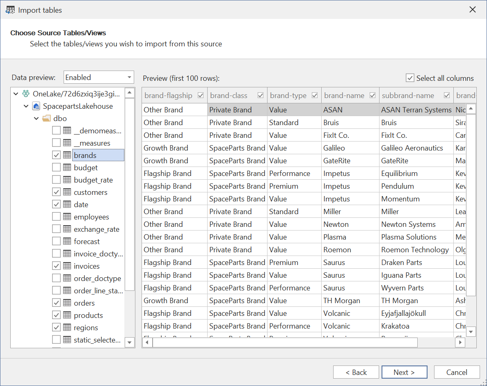
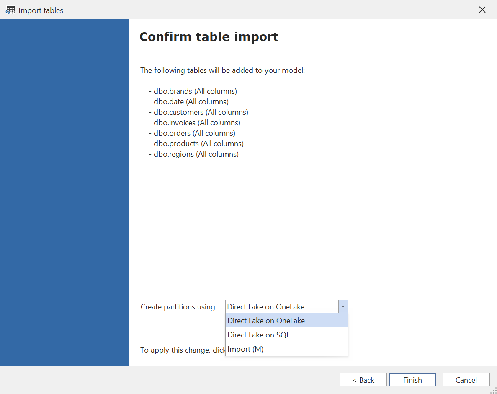
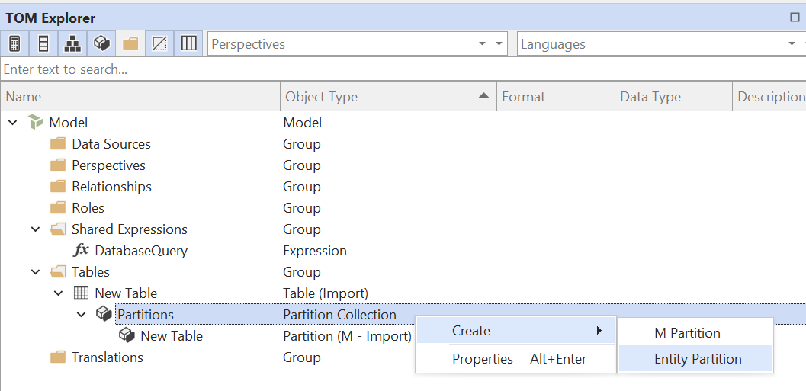
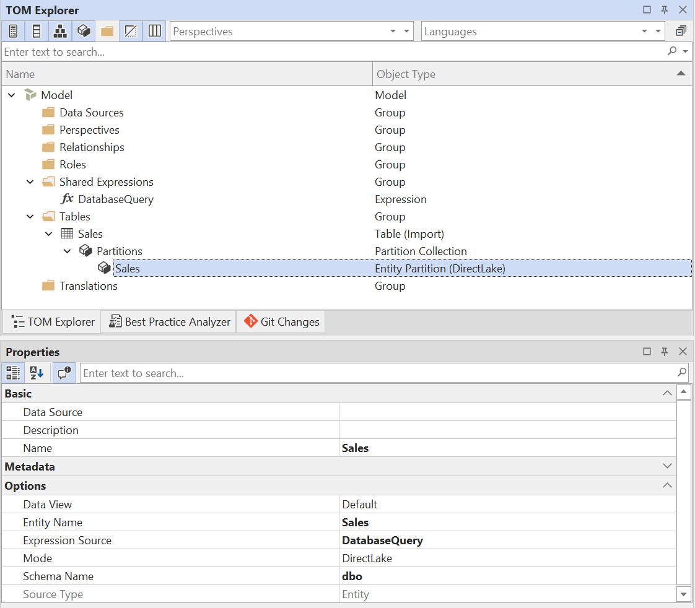
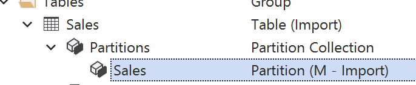

---
uid: direct-lake-guidance
title: Direct Lake 指南
author: Morten Lønskov
updated: 2026-10-26
applies_to:
  products:
    - product: Tabular Editor 2
      partial: true
    - product: Tabular Editor 3
      since: 3.22.0
      editions:
        - edition: Desktop
          none: true
        - edition: Business
          none: true
        - edition: Enterprise
          full: true
---
# Direct Lake 指南

随着 Tabular Editor 3.22.0 的发布，除了 Direct Lake on SQL 外，我们还增加了对 Direct Lake on OneLake 的支持。本文简要概述了这两种模式之间的差异，以及它们与 Power BI 语义模型中提供的其他存储模式的比较。

## 存储模式概述

下表总结了 Power BI 语义模型中可用的存储模式：

| 存储模式 | 描述 | 推荐用例 |
|--------------|-------------|-----------------------|
| 导入       | 数据被导入语义模型并存储在模型的内存缓存（VertiPaq）中。| 当您需要快速的查询性能，并且可以承受定期刷新数据时。|
| DirectQuery  | 在查询时直接从源查询数据，而无需将其导入模型。支持各种源，例如 SQL、KQL 甚至其他语义模型。| 当您需要实时数据访问，或者当数据量太大而无法放入内存时。|
| 双重         | 一种混合模式，其中引擎可以根据查询语境选择返回导入的数据或委派给 DirectQuery。| 当您的模型包含 DirectQuery 表格和导入表格的混合（例如在使用聚合时），并且您有与两者都相关的表格时。|
| Direct Lake on OneLake | 使用 Delta Parquet 存储格式，在需要时将数据快速交换到语义模型内存中。| 当您的数据已在 Fabric 仓库或湖仓中以表或物化视图的形式提供时。|
| Direct Lake on SQL | 旧版本的 Direct Lake，它使用 Fabric 仓库或湖仓的 SQL 分析端点。| 不建议用于新开发（请改用 Direct Lake on OneLake）。|

> [!NOTE]
> 还可以创建包含**导入**和**DirectQuery**模式下分区组合的表（也称为“混合表”）。这通常在需要增量刷新的大型事实表上进行，同时直接从源查询一些数据。有关详细信息，请参阅[这篇文章](https://learn.microsoft.com/power-bi/connect-data/incremental-refresh-xmla)。

## Direct Lake on OneLake 与 Direct Lake on SQL

[Direct Lake on OneLake](https://learn.microsoft.com/fabric/fundamentals/direct-lake-overview#key-concepts-and-terminology) 于 2025 年 3 月推出，是 Direct Lake on SQL 的替代方案。使用 Direct Lake on OneLake，不存在对 SQL 端点的依赖，也不会回退到 DirectQuery 模式。这也意味着[适用于 DirectQuery 模型的常见限制](https://learn.microsoft.com/power-bi/connect-data/desktop-directquery-about#modeling-limitations)不适用于 Direct Lake on OneLake 模型。

> [!NOTE]
> Direct Lake on OneLake 目前处于公开预览阶段。您必须在 Fabric 管理门户中启用租户设置**用户可以创建 Direct Lake on OneLake 语义模型（预览）**，然后才能使用此表存储模式创建语义模型。

但是，与 Direct Lake on SQL 一样，仍存在一些[确实适用的限制](https://learn.microsoft.com/fabric/fundamentals/direct-lake-overview#considerations-and-limitations )。主要限制包括：

- 预览版支持 Direct Lake on OneLake 表上的计算列，并且仅支持 `UserContext` 表达式上下文。Direct Lake on SQL 不支持计算列。请参阅[Direct Lake on OneLake 上的计算列](#calculated-columns-on-direct-lake-on-onelake)。
- 计算表不能引用 Direct Lake 存储模式中的列或表。支持计算组、假设分析参数和字段参数，因为它们会创建不引用 Direct Lake 列的隐式计算表格。
- 不支持将非物化 SQL 视图作为 Direct Lake on OneLake 表的数据源。使用物化视图，或确保源 Delta 表包含您需要的列。
- 在 Direct Lake on OneLake 的公开预览期间，不支持将湖仓中的快捷方式作为数据源。

有关完整且最新的限制列表，请参阅[Microsoft 有关 Direct Lake 注意事项和限制的文档](https://learn.microsoft.com/fabric/fundamentals/direct-lake-overview#considerations-and-limitations)。

### Direct Lake on OneLake 上的计算列

Direct Lake on OneLake 表上的计算列必须将其 `ExpressionContext` 属性设置为 `UserContext`。该列在查询时进行评估，且未物化，因此无法在关系中使用。新计算列默认使用 `Standard`。如果您在将模型保存到 Power BI 服务时将 Direct Lake 表中的计算列设置为`Standard`，则保存将失败，并显示错误“默认表达式上下文不能用于 Direct Lake 表中的计算列”。

只有当模型的兼容级别为 1705 或更高时，**表达式上下文**属性才会显示在 @properties-view 中。在 Direct Lake on OneLake 表的每个计算列上设置该属性：

1. 在 @tom-explorer-view 中选择模型，然后在 @properties-view 的**数据库**下勾选**兼容级别**。如果低于 1705，请按照 @update-compatibility-level 中的说明升级模型。
2. 在 @tom-explorer-view 中选择计算列。
3. 在@properties-view的**选项**下，将**表达式上下文**设置为`UserContext`。
4. 保存模型。

同一模型中导入表格上的计算列可以使用任一表达式上下文。对于无法引用用户上下文列的对象，请参阅 @user-context-calculated-columns。Microsoft 在[在 Power BI Desktop 中使用计算列](https://learn.microsoft.com/power-bi/transform-model/desktop-calculated-columns#materialization-and-performance)中列出了受支持的存储模式和表达式上下文组合。

### 复合模型

如果您需要一个已物化或可用作关系键的计算列，请通过将 Direct Lake 表与导入表相结合来创建**复合模型**，并将计算列添加到导入表中。Direct Lake on OneLake 支持此操作，但 Direct Lake on SQL 不支持。在复合模型中，您通常将较大的事实表保留在Direct Lake模式下，同时对需要完整计算列或自定义分组的较小维度表使用导入模式。

Direct Lake on OneLake 还支持通过基于 XMLA 的工具（例如 Tabular Editor）与 DirectQuery 表组合。可以通过 Power BI Web 建模、Power BI Desktop（实时编辑）或通过 XMLA 工具添加导入表格。

> [!NOTE]
> Direct Lake on SQL 不支持复合模型。您不能在同一语义模型中将 Direct Lake on SQL 表与导入、DirectQuery 或双存储模式表相结合。但是，您可以使用 Power BI Desktop 在 Direct Lake on SQL 语义模型*之上*创建复合模型，并使用新表对其进行扩展。有关详细信息，请参阅[在语义模型上构建复合模型](https://learn.microsoft.com/power-bi/transform-model/desktop-composite-models#building-a-composite-model-on-a-semantic-model-or-model)。

## 排序规则

使用**Direct Lake on OneLake**时，模型的排序规则与导入模型的排序规则相同，默认情况下不区分大小写。

对于**Direct Lake on SQL**模型，对于不回退到 DirectQuery 的查询，排序规则不区分大小写。如果查询确实回退，则排序规则取决于源的排序规则。对于 Fabric 仓库，排序规则可能区分大小写，在这种情况下，您应在模型上指定[区分大小写的排序规则](https://data-goblins.com/power-bi/case-specific)。

> [!NOTE]
> 元数据部署到 Analysis Services/Power BI 后，您就无法更改模型的排序规则。因此，如果您计划将 Direct Lake on SQL 与区分大小写的 Fabric 仓库配合使用，则必须在部署模型元数据之前设置其排序规则：
>
> 1. 在 Tabular Editor 3 中创建新模型（“文件”>“新建”>“模型”……）
> 2. 取消选中“使用工作区数据库”
> 3. 将模型的**排序规则**属性设置为`Latin1_General_100_BIN2_UTF8`
> 4. 保存模型 (Ctrl+S)。
> 5. 现在，从您刚才保存的文件中打开模型。当系统提示您连接到工作区数据库时，请选择“是”。
>
> 采用此方法，模型元数据从一开始就以正确的排序规则进行部署，然后您可以在 Direct Lake on SQL 模式下添加表，而不会遇到排序规则问题。

## 表格导入向导

要使用 Tabular Editor 3 的“表格导入向导”添加 Direct Lake 表格，请选择**Microsoft Fabric 湖仓**、**Microsoft Fabric 仓库**、**Microsoft Fabric SQL 数据库**或**Microsoft Fabric 镜像数据库**作为源：


登录后，系统将显示您有权访问的工作区中所有可用 Fabric 湖仓/仓库的列表。选择您想要连接的对象，然后点击**确定**：


除非您想指定自定义 SQL 查询，或将表配置为 DirectQuery 模式，否则只需点击**下一步**，即可从源中的表/视图列表中选择表：


选择要导入的表/视图。请注意，Direct Lake on OneLake 模式不支持**非物化视图**。尝试将此类视图添加到模型中，将在保存模型元数据时导致错误。



在最后一页上，选择要用于配置表分区的模式：



选项有：

- Direct Lake on OneLake
- Direct Lake on SQL
- 导入 (M)

> [!NOTE]
> 如果您正在处理的模型已经包含表，并且该模型不支持将不同存储模式的表组合在一起，则上述一个或多个选项可能不可用。例如，如果模型包含一个处于 Direct Lake on SQL 模式下的表，则您无法添加处于其他模式下的表。

导入的表格已包含其列，顺序与源中相同，因此您无需在导入后运行**更新表架构**。如果 Tabular Editor 无法确定湖仓或仓库的 SQL 分析端点，且导入设置未指定端点，则导入将失败，并显示指明缺失设置的错误，且不会创建任何表。

## 检查 Direct Lake 分区

Direct Lake 分区没有查询表达式。当您在 @tom-explorer-view 中选择一个分区时，**表达式编辑器**会显示其`Data Coverage Definition Expression`；如果分区没有数据覆盖范围定义，则不显示任何内容。由增量刷新策略生成的分区表现方式相同。

## Power Query (M) 表达式

本节包含有关如何配置 TOM 对象和属性的更技术性的说明，以防您想在不使用“表导入向导”的情况下手动为 Direct Lake 模式设置表。

### Direct Lake on OneLake

要手动为**Direct Lake on OneLake**模式设置表，您需要执行以下操作：

1. **创建共享表达式**：Direct Lake 表格使用“实体”分区，这些分区必须引用模型中的共享表达式。如果还没有此共享表达式，请先创建它。将其命名为`DatabaseQuery`：


2. **配置共享表达式**：将您在第 1 步中创建的表达式的**类型**属性设置为“M”，并将**表达式**属性设置为以下 M 查询，替换 URL 中您的 Fabric 工作区和湖仓/仓库的 ID：

```m
let
    Source = AzureStorage.DataLake("https://onelake.dfs.fabric.microsoft.com/<workspace-id>/<resource-id>", [HierarchicalNavigation=true])
in
    Source
```

3. **创建表格和实体分区**：在模型中创建新表格 (Alt+5)，然后在 TOM Explorer 中展开表格分区，并创建新的*实体分区*：
  
  

  删除在您创建表时自动创建的常规导入分区。

4. **配置实体分区**：在实体分区上设置以下属性：

| 属性 | 值 |
| ----------|-------|
| 名称 | （建议）设置为与表相同的名称 |
| 实体名称 | （必填）设置为湖仓/仓库中表的名称 |
| 表达式源 | （必填）设置为您在第 1 步中创建的共享表达式，通常为 `DatabaseQuery` |
| 模式 | （必填）`DirectLake` |
| 架构名称 | （可选）设置为 Lakehouse/仓库中的架构名称（如果适用）。未设置时，将使用默认架构。|

  最终结果应如下所示：



5. **更新列元数据**：在此阶段，您应该能够使用 Tabular Editor 的**更新表架构**功能来更新表的列元数据。这将自动从湖仓/仓库中检索列名称和数据类型：


  或者，手动将数据列添加到表（Alt+4），并为每一列指定`Name`、`Data Type`、`Source Column`以及任何其他相关属性。

> [!NOTE]
> 将 Direct Lake 表添加到模型时，在第一次元数据部署后需要手动“刷新”该表。否则，查询时该表将不包含任何数据。此刷新只需执行一次。如果选中**工具 > 首选项 > 模型部署 > 数据刷新**下的**保存新表时自动刷新**，Tabular Editor 3 将在保存模型元数据时自动刷新表。

### Direct Lake on SQL

要手动设置**Direct Lake on SQL**模式的表，请按照上面“Direct Lake on OneLake”部分的步骤操作，但请改用以下 M 查询作为共享表达式：

```m
let
    database = Sql.Database("<sql-endpoint>", "<warehouse/lakehouse name>")
in
    database
```

将`<sql-endpoint>`替换为[Fabric 仓库](https://learn.microsoft.com/fabric/data-warehouse/query-warehouse)或[湖仓](https://learn.microsoft.com/fabric/data-engineering/lakehouse-sql-analytics-endpoint)的 SQL 分析端点的连接字符串，并将`<warehouse/lakehouse name>`替换为仓库或湖仓的名称。

### 从 Lakehouse/Warehouse 导入

如果您想在从 Fabric 湖仓或仓库获取数据时将表配置为**导入**模式，则步骤如下：

1. **创建表格**：在模型中创建新表格 (Alt+5)，然后在 TOM Explorer 中展开表格分区。默认情况下，您应该会看到一个自动创建的“导入”类型分区：



2. **配置导入分区**：在导入分区上设置以下 M 查询：

```m
let
    Source = Sql.Database("<sql-endpoint>","<warehouse/lakehouse name>"),
    Data = Source{[Schema="<schema-name>",Item="<table/view-name>"]}[Data]
in
    Data
```

将“`<sql-endpoint>`”替换为[Fabric 仓库的 SQL 分析端点](https://learn.microsoft.com/fabric/data-warehouse/query-warehouse)或[湖仓](https://learn.microsoft.com/fabric/data-engineering/lakehouse-sql-analytics-endpoint)的连接字符串，并将“`<warehouse/lakehouse name>`”替换为仓库或湖仓的名称。

将`<schema-name>`替换为仓库/湖仓中的架构名称，将`<table/view-name>`替换为您要导入的表或视图的名称。请注意，导入模式下的表格可以使用非物化视图作为数据源，因为在刷新操作期间，数据是通过 SQL 端点查询的。

3. **更新列元数据**（仅限手动设置）：由于您手动配置的分区没有列，请使用 Tabular Editor 的**更新表架构**功能从湖仓/仓库检索列名称和数据类型。或者，手动创建数据列（ **Alt+4** ），并为每一列指定`Name`、`Data Type`、`Source Column`以及任何其他相关属性。

## 在存储模式之间进行转换

使用本文中的信息，在 Direct Lake on SQL 和 Direct Lake on OneLake 之间进行转换非常简单，因为您只需修改 Direct Lake 分区引用的共享表达式的 M 查询即可。

如果您想从导入模式转换为 Direct Lake 模式，由于涉及的分区类型不同，操作会略微复杂一些。

为了让事情变得更简单，我们准备了一组 C# 脚本，可以帮助您在不同的存储模式之间进行转换：

- [将 Direct Lake on SQL 转换为 Direct Lake on OneLake](xref:script-convert-dlsql-to-dlol)
- [将导入转换为 Direct Lake on OneLake](xref:script-convert-import-to-dlol)